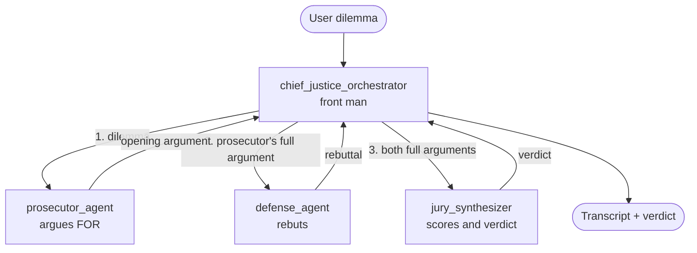
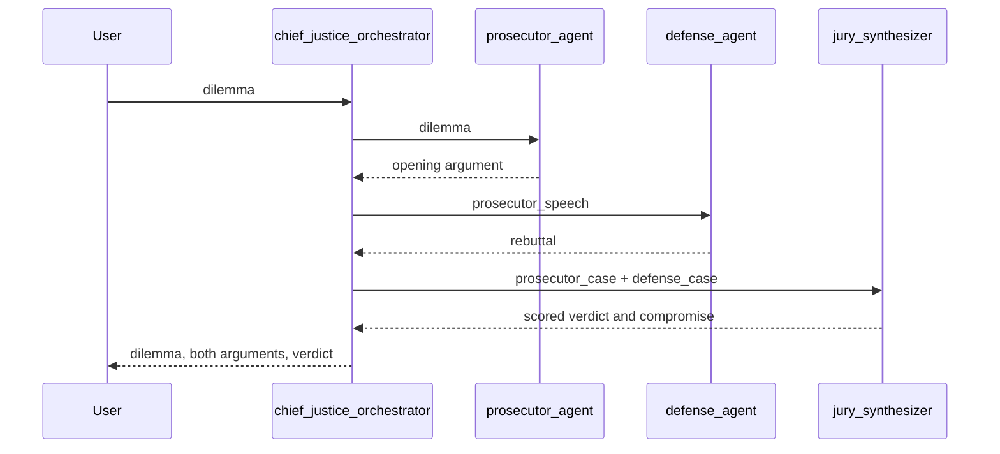

# Architecture

The Crucible is a single Neuro SAN agent network defined in
[`registries/the_crucible.hocon`](registries/the_crucible.hocon). There is no custom Python:
agents, their instructions, and the way they call each other are all declarative configuration.

## Agents and call graph

## Sequence

## Design notes

- **Front man pattern.** Only `chief_justice_orchestrator` talks to the user. The other three are
  down-chain agents it lists under `tools`, so each one is a focused specialist with a narrow prompt.
- **Adversarial by design.** The prosecutor and defense have deliberately opposed personas, so the
  jury receives strong arguments from both sides instead of one balanced but bland answer.
- **Sequential dependency.** The defense must see the prosecutor's actual words and the jury must see
  both, so the steps cannot run in parallel. The orchestrator's prompt requires passing each argument
  through verbatim, because paraphrasing it would weaken the rebuttal.
- **Typed hand-offs.** Each specialist declares a `parameters` schema (`dilemma`, `prosecutor_speech`,
  `prosecutor_case` / `defense_case`), which makes the hand-off between agents explicit.
- **One model setting.** All agents include `config/llm_config.hocon`, so the model is changed in a
  single file.

## Configuration files

| File | Purpose |
| --- | --- |
| `registries/the_crucible.hocon` | The agent network |
| `registries/manifest.hocon` | Lists the networks the server exposes |
| `registries/expertise_scoping_instructions.hocon` | Reusable prompt (not a network) included by the Chief Justice so it only handles debate requests |
| `config/llm_config.hocon` | Shared LLM provider and model |
| `config/plugins.hocon` | Server plugins (log bridge on, Phoenix tracing off) |

## Known limitations

- The debate quality depends on the configured model. The default `openrouter/free` can route to
  models that are weak at tool calling.
- Each run makes at least four LLM calls and the arguments are long, so a full debate is slow on
  free-tier models.
- The jury's 1-10 scores come from a language model, not a fixed rubric, so they are illustrative
  rather than consistent between runs.